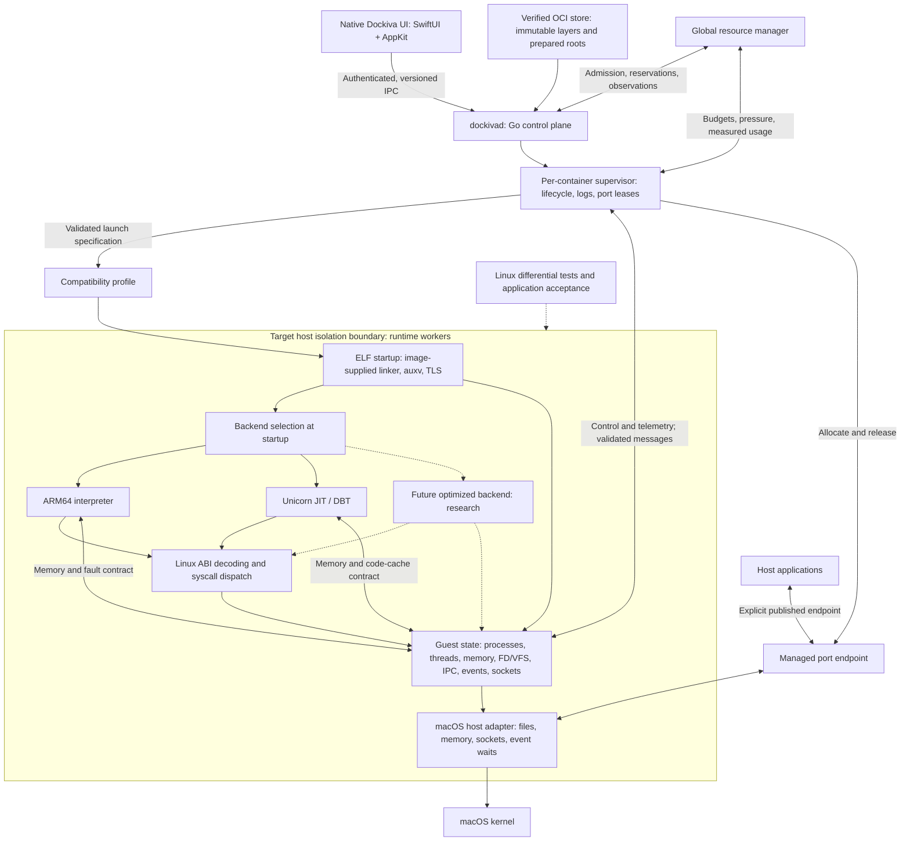

# Target architecture and component contracts

Design baseline: [frozen architecture v1.0](FINAL-ARCHITECTURE-V1.md), adopted
2026-09-22. These contracts are subordinate implementation details; implementation
and qualification remain open. This records the agreed Dockiva architecture and the
contracts needed to build it incrementally. It does not accept M54 or any release
milestone. [The status ledger](MILESTONE-STATUS.md) remains authoritative.

## Target structure

The boundary is a required protection property, not a claim that a host process
or private root directory already supplies it. Its macOS enforcement mechanism
must pass a separate feasibility and security gate. Worker count and placement
are also explicit design decisions: one container may contain several guest
processes and threads; it is not defined as one host process.

SwiftUI/AppKit is the required production macOS UI. Vue/Wails remains the current
development desktop during migration; replacing it is not a prerequisite for
Linux semantic work. Production execution is UI -> Go dockivad -> C runtime,
without Python. Python remains allowed for development tests, fuzzing, tracing
and benchmarks. The control plane stays outside guest instruction and application
request paths. Linux ARM64 is primary; x86-64 -> ARM64 DBT is a deferred target.

The final specification governs top-level technology, scope and gate decisions.
Routine work evolves within those boundaries. A boundary change needs a recorded
conformance failure or measured feasibility result, considered alternatives and
an explicit amendment; updating the status ledger alone cannot alter the baseline.

## Baseline implementation clarifications

- A runtime dylib is a packaging unit, not an isolation boundary. Load it in a
  supervised worker with restricted authority; keep guest execution outside the
  trusted daemon. The diagram's host adapter placement describes logical layering,
  not permission to bypass worker confinement.
- "ARM64 primary backend" denotes the selected qualified backend for that guest
  architecture, not proof of direct-native execution. Interpreter/Unicorn are the
  current implementations. Future native translation and AMD64 translation must
  pass the same semantic, memory and isolation contracts before support is claimed.
- The compatibility analyzer reports SUPPORTED, COMPATIBLE, EXPERIMENTAL or
  UNSUPPORTED with reasons and the image digest, configuration, runtime/backend
  version and evidence scope. COMPATIBLE is an unqualified prediction. Missing
  static evidence never becomes a guarantee of runtime behavior; unknown dynamic
  requirements must produce explicit diagnostics when encountered.
- Only the image-supplied dynamic linker executes as guest code; procfs belongs
  to VFS. Backend views share one authoritative guest page/backing model, with
  explicit invalidation on changes and no full RAM copy per backend.
- Valkey V0–V11 is the first major compatibility gate; PostgreSQL P0–P12 is the
  second. [Workload gate definitions](WORKLOAD-GATES-V1.md) retain Redis as a
  regression workload, with no transfer of its evidence to Valkey or PostgreSQL.
- Fix generic Linux semantics, never branch on application name inside syscall
  or execution behavior. The prepared Redis fixture now uses a versioned digest/capability profile;
  its evidence remains limited to the prepared fixture. It must not conceal missing semantics or waive stock-binary gates.
- Process, memory, descriptor and event development is interdependent. Run small
  semantic and real-application probes continuously. Defer broad optimization,
  AMD64 execution and self-healing automation until semantic gates are stable;
  keep basic performance/pressure measurements and bounded execution during work.

## Current implementation map

| Target component | Current code and evidence | Remaining work |
|---|---|---|
| Native desktop | Current Dockiva Vue/Wails application | Required SwiftUI/AppKit migration; current test desktop stays usable during runtime work |
| Go daemon | [Go dockivad](../dockivad/) now implements the supported preview API; [migration evidence](DOCKIVAD-GO-MIGRATION-2026-09-22.md) | Broader Docker API, extended compatibility analysis and production qualification |
| OCI store | Go [image.go](../dockivad/image.go), [registry.go](../dockivad/registry.go); Python retained for development/reference | Shared immutable storage, crash-safe reclamation and broader image semantics |
| Supervisor | Go [lifecycle.go](../dockivad/lifecycle.go), C [worker guard](../native/worker_launcher.c); legacy-state/crash checks pass | Richer worker protocol, wider failure corpus and independently verified confinement |
| Profile | [Versioned digest profiles and native capability negotiation](COMPATIBILITY-PROFILES-2026-09-22.md); persisted policy and Inspect metadata | Broader static dependency analysis, optional-feature negotiation and production qualification |
| Loader/backend | [runtime.c](../native/runtime.c), [unicorn_backend.h](../native/unicorn_backend.h) | Explicit state ownership and common backend interface |
| Process/thread state | [process.h](../native/process.h), [scheduler.h](../native/scheduler.h), [unicorn_threads.h](../native/unicorn_threads.h) | Unify ownership; [bounded private fork](PAGE-COW-UNICORN-FORK-2026-09-23.md) now has an engine/address space/FD table per process and up to eight cooperative tasks across groups; full signal/clone/exec semantics remain open |
| Memory | [address_space.h](../native/address_space.h), [heap.h](../native/heap.h), [mapping.h](../native/mapping.h); explicit state, macOS host-page COW, Unicorn write faults and revision-driven full/incremental synchronization tested | MAP_SHARED, portable page COW, shared process ownership and full coherence |
| FD/VFS/events/network | [fs.h](../native/fs.h), [io.h](../native/io.h), [epoll.h](../native/epoll.h), [net.h](../native/net.h) | Common object identity; broader Linux semantics and managed endpoint publication |
| Resource accounting | [resources.h](../native/resources.h), capacity admission in Go lifecycle.go, host rlimits | Full worker-tree accounting including Unicorn/JIT, measured pressure feedback and enforceable global policy |
| Application evidence | [Redis recovery](REDIS-CONCURRENCY-RECOVERY-2026-09-22.md), [Dockiva Redis bundle](DOCKIVA-REDIS-PREVIEW-2026-09-22.md) | PostgreSQL/Valkey services, stock-image qualification and production workloads |

Current allocation counters are not total resident memory. Current admission is
limited to a state store (four active runtimes and 1024 MiB of reserved guest
allocations); it is not a machine-wide RAM manager. Published ports in the target
diagram are future functionality; today's Dockiva preview uses host loopback.

## State ownership contract

All identifiers below are opaque and generation-checked. Guest identifiers are
never host PIDs, descriptors or pointers used as authority. References keep shared
objects alive; teardown releases them exactly once. Reusing an identifier must
not revive a stale waiter, event or supervisor command.

| Owner/object | Owns or references | Required behavior |
|---|---|---|
| Container | Process registry, root/mount policy, IPC/network scope, profile, budget | Exit/kill/restart addresses the complete container; unrelated containers retain their state |
| Process | PID/parent, address space, descriptor table, filesystem context, signal dispositions, exit state | fork/clone sharing follows supported Linux flags; successful exec replaces the image; failed exec preserves the old image |
| Thread | TID, CPU context including SIMD/TLS, signal mask, pending thread signals, wait state | Context switch preserves architectural state; exit/clear-TID wakes the correct waiter |
| Address space | Virtual mappings referencing backing objects and offsets | Private writes stay private after fork; shared writes are visible to the intended peers; protections apply through every backend |
| FD table | Entries containing object references and descriptor-local flags | dup/fork retain the same open file description; close releases one reference; exec honors close-on-exec |
| Open file description | File offset, status flags, file/pipe/socket/event object | Shared offsets and nonblocking state remain consistent across aliases |
| Event/IPC object | Waiters and stable references to watched/shared objects | Timeouts, cancellation, close and readiness race safely without lost wakes or stale delivery |

Process signal dispositions and thread signal masks must not be conflated.
Filesystem contexts and FD tables may themselves be shared by supported clone
flags. A private futex key includes address-space identity and guest address; a
shared futex key uses shared backing identity and offset. Equal virtual addresses
in unrelated processes must not accidentally share a wait queue.

Start with cooperative execution and explicit locking/ownership rules. Introducing
parallel host execution requires a separate memory-ordering and race-validation
gate. The interpreter is a useful comparison implementation; ARM64 Linux is the
semantic reference, since two local backends can share the same bug.

## Component interfaces

These names specify intended interfaces, not functions already implemented.

| Component | Requests/results | Contract and failure behavior |
|---|---|---|
| Control plane | `Create`, `Start`, `Stop`, `Inspect`, `Remove`; operation ID and container generation | Authenticate and validate before mutation; serialize conflicting transitions; retrying the same operation does not create duplicate workers; unsupported options return explicit errors |
| Image store | `Resolve(digest)`, `Prepare(config)`, `Lease(root)`, `Release(lease)` | Verify content before use; published roots are immutable; mutable container state is separate; never reclaim a live lease; failed preparation leaves no published partial image |
| Supervisor | `Launch(spec)`, `Stop(grace)`, `Kill`, `Observe`; lifecycle events with sequence and generation | Record exit reason and retain bounded logs; graceful stop delivers a guest signal before escalation; daemon reconnection uses authenticated ownership, not a remembered PID alone |
| Compatibility profile | Schema version, image digest, ABI/ISA features, backend requirements, resource/security/network policy | Negotiate required capabilities before launch; unknown required features reject launch; optional features never imply fake syscall success; inspect reports effective profile and backend |
| Loader | `Load(image, argv, env, address_space)` -> entry context or structured failure | Execute the image-supplied linker; prepare ABI startup state; stage exec before commit; procfs belongs to VFS; advertise only provided auxv/vDSO capabilities |
| Backend | `Create`, `Run(thread, budget)`, `Save/Restore`, `Invalidate(range)`, `Destroy` | Return typed syscall, fault, yield or exit events; preserve CPU state; yield within a bounded interval; never own an independent copy of Linux syscall semantics |
| Personality | `Dispatch(thread, syscall, guest_args)` -> value/errno, blocked wait, exec or exit | Decode guest structures explicitly; validate ranges and arithmetic; route to shared state services; preserve Linux partial-result/error behavior within declared support |
| Host adapter | Capability-scoped file/socket/memory/event operations | Translate host errors explicitly; no arbitrary host path or descriptor access from guest values; host completions return to guest state before waking a thread |
| Resource manager | `Reserve`, `Commit`, `Release`, `Observe`, `Pressure` | Reserve before launch; reconcile on crash/reconnect; never release a live worker's charge solely because telemetry is late; workers retain local limits if daemon disconnects |

Backend selection occurs at startup. There is no automatic switch to a VM or to
a less restricted profile on failure. Runtime backend switching is deferred.
Native translation must preserve the same syscall, fault, memory and confinement
contracts before becoming a supported backend.

### Memory and translation-cache coherence

The memory service is authoritative. A mapping mutation pauses affected guest
execution, validates and stages the change, updates all affected backend mappings
and invalidates translations/lookups, then publishes the new generation before
resuming execution. Failure must preserve the previous valid state or terminate
the affected worker explicitly; execution with stale mappings is forbidden.

Guest and host writes to executable backing, protection changes, unmap/remap and
backing replacement participate in this protocol. Shared backing invalidations
reach every affected address space. Support for writable executable guest pages
must be explicit; unsupported profiles reject it rather than bypassing coherence.
Host JIT write/execute permissions remain a separate platform obligation.

### Networking and wait ownership

Each socket has one shared identity referenced by FD/VFS, network semantics and
event registration. A single wait service handles readiness, timeouts, signals
and cancellation. Host kqueue/poll readiness is input to this service, not the
definition of Linux epoll behavior. Blocking a guest must not block all unrelated
runnable guests. Prevent lost wakeups by atomically checking state and registering
the wait under the applicable synchronization rule.

The daemon grants an endpoint lease for protocol/address/port; the supervisor
owns its lifecycle. Reserve the actual host resource before reporting success;
do not rely on a check-then-bind gap. Release only after the endpoint is closed.
Port publication does not by itself implement network namespaces or container DNS.
Choose a broker or delegated socket design in the isolation spike; do not assume
an unconfined listener can serve as the production security boundary.

### Resource and isolation policy

Report guest allocation bytes, worker resident/physical-memory measurements,
CPU time, JIT cache usage, descriptor/thread counts and reserved budgets as
separate fields, with timestamp and explicit unavailable values. Include UI,
daemon, supervisors, runtime libraries and caches in product measurements. Do not
sum shared-memory RSS and label the result unique physical memory.

Under pressure, first reclaim disposable caches through supported backend APIs,
then restrict admissions or CPU allocation. Never discard live guest data. A hard
limit failure has a documented guest error or container termination reason; it
must not silently corrupt or reset the workload. If a backend cannot measure or
bound its cache, record the gap and block claims of an enforced total budget.
Workers enforce allocation/execution limits locally; the supervisor must retain
the ability to terminate a stuck worker independently of guest cooperation.

Workers receive minimum host authority; engine credentials, unrelated roots and
supervisor control channels are not guest capabilities. Validate every worker
message even though the worker was started by our daemon. Directory mediation,
JIT entitlement and rlimits alone do not qualify hostile-code containment.
Listener-capable confinement is an early feasibility gate, while independent
security assessment remains a release gate.

## Delivery sequence and acceptance gates

These are implementation slices within existing milestones, not new milestone
numbers. Each slice preserves the pinned prepared Redis and HTTP/shell baseline.
No rewrite of the desktop or daemon is required to start.

| Slice | Concrete delivery | Acceptance gate | Roadmap relationship |
|---|---|---|---|
| A: state and backend boundary | Introduce explicit container/process/thread/address-space ownership and backend operations around existing behavior; migrate incrementally from globals | A1: alternating independent contexts retain registers, TLS, memory and descriptors; A2: teardown/error paths leak no owned resources; shared corpus matches both backends and Linux where supported; existing Redis evidence reruns pass | M34–M38, M54–M55 |
| B: process and shared objects | Implement fork/clone/exec/wait relationships, shared backing and unified descriptor ownership in the active database backend | B1: fork private writes diverge, shared writes propagate; B2: dup/fork offsets and close-on-exec match Linux; B3: failed exec preserves parent/image state; B4: shared futex wake, exit and signal cancellation races pass | M34–M38, M44–M47 |
| C: database workflows | Resolve observed application gaps using shared services; Valkey is the first major gate, PostgreSQL the second | C1: Valkey V0–V11, including stock ARM64 binary, BGSAVE/COW, AOF rewrite and recovery; C2: PostgreSQL P0–P12, including WAL crash recovery, validation and stress; retain Redis regressions and distinguish prepared-ELF/stock-image results | M46–M48 |
| D: resource and isolation enforcement | Add measured worker-tree accounting, pressure protocol and listener-capable confinement; begin the confinement feasibility spike during A | D1: concurrent launch cannot exceed reservations; D2: daemon/worker crash releases only dead ownership; D3: cache pressure retains database data; D4: hostile guest attempts cannot reach unrelated files, engine credentials or forbidden endpoints | M31, M59–M63, M76 |
| E: production desktop/control plane | Replace Python orchestration with Go dockivad and deliver SwiftUI/AppKit UI against versioned IPC, preserving state migration and rollback | E1: same lifecycle suite through old/new clients; E2: reconnect/retry/crash cannot duplicate workers or lose state; E3: production process tree has no Python dependency; E4: native UI can restart while workloads continue; E5: signed clean-Mac package passes distribution gates | M49–M53, M70–M73 |
| F: measured optimization | Improve Unicorn integration; evaluate a future backend only against measured bottlenecks | F1: backend conformance remains passing; F2: equal workloads compare total memory, CPU, latency and energy with named baselines; F3: actual 8 GB hardware passes the selected workload and pressure/recovery gates | M54–M58, M76–M77 |

Backend-specific unsupported tests remain explicit exclusions, never silent skips
counted as passing. A migration slice must not reduce the existing supported set.
Cross-backend tests start with their shared supported subset and expand alongside
the capability contract.

## First implementation change

Progress: the [first CPU-state extraction](CPU-STATE-OWNERSHIP-2026-09-22.md) is
implemented and tested. CPU ownership, process snapshots and explicit Unicorn
register transfer are in place. [Address-space state and backend synchronization](ADDRESS-SPACE-OWNERSHIP-2026-09-22.md)
are now extracted and tested too. [Reference-counted backing and offset views](MEMORY-BACKING-OWNERSHIP-2026-09-22.md)
are implemented. [Private interpreter fork COW](PRIVATE-FORK-COW-2026-09-22.md) now
retains backing and detaches it on writable access. [Unicorn write-fault COW](UNICORN-COW-FAULTS-2026-09-22.md)
now defers shared backing copies until guest stores. [macOS host-page COW and
bounded Unicorn fork](PAGE-COW-UNICORN-FORK-2026-09-23.md) additionally pass generic process/descriptor tests
and prepared Redis BGSAVE/AOF rewrite with restart isolation. MAP_SHARED, full
FD/signal ownership, scheduler unification and the full execution interface
remain open; slice A is not yet accepted.

Start slice A with a small state-ownership extraction, not a wholesale scheduler
rewrite. Introduce a runtime context for the existing single address space and
explicit thread CPU state; pass context through the backend boundary while
preserving current limits and behavior. Inventory each migrated global and its
owner. Do not claim fork or shared-memory support from this refactor.

Exercise context initialization, switching and teardown with independent guest
values, then run the existing backend/thread verifiers, prepared Redis query and
recovery verifiers, and final bundled Dockiva adapter test. Preserve commands,
binary/image hashes, structured results and supported-scope exclusions in a new
evidence directory. Investigate a changed result before proceeding to slice B.
Current entry points are [backend verification](../scripts/verify_unicorn_backend.py),
[thread verification](../scripts/verify_unicorn_threads.py),
[Redis queries](../scripts/verify_redis_unicorn.py) and
[Redis recovery](../scripts/verify_redis_recovery.py); use their documented arguments.

Application acceptance includes BusyBox, Go, nginx, Redis, Valkey and PostgreSQL,
with versions, images, configuration and workloads pinned before each gate.
Startup-only results are insufficient: include concurrent requests, cancellation,
filesystem effects, restart/crash recovery and bounded failure. Differential
fixtures run against ARM64 Linux; local agreement alone is not Linux conformance.

## Semantic references

The following primary references informed the design discussion. Pin their
revisions with each conformance corpus before implementation expands the ABI:

- [Linux open-file descriptions](https://man7.org/linux/man-pages/man2/open.2.html)
- [Linux epoll lifetime and alias behavior](https://man7.org/linux/man-pages/man7/epoll.7.html)
- [Linux futex operations](https://man7.org/linux/man-pages/man2/futex.2.html)
- [PostgreSQL process and shared-memory architecture](https://www.postgresql.org/docs/17/connect-estab.html)
- [Unicorn's QEMU-derived CPU engine](https://www.unicorn-engine.org/docs/beyond_qemu.html)
- [Apple Silicon JIT requirements](https://developer.apple.com/documentation/apple-silicon/porting-just-in-time-compilers-to-apple-silicon)

### Slice E control-plane checkpoint — 2026-09-22

E1–E3 have scoped preview evidence: existing Dockiva clients run against Go/C,
crash/reconnect cannot duplicate the tested workers, legacy state/control migration
passes, and the built helper/process tree contain no Python. E4 native UI and E5
production distribution remain open. The migration does not close slice E as a
whole or establish the complete control-plane resource/networking contracts.
See [the implementation report](DOCKIVAD-GO-MIGRATION-2026-09-22.md).
